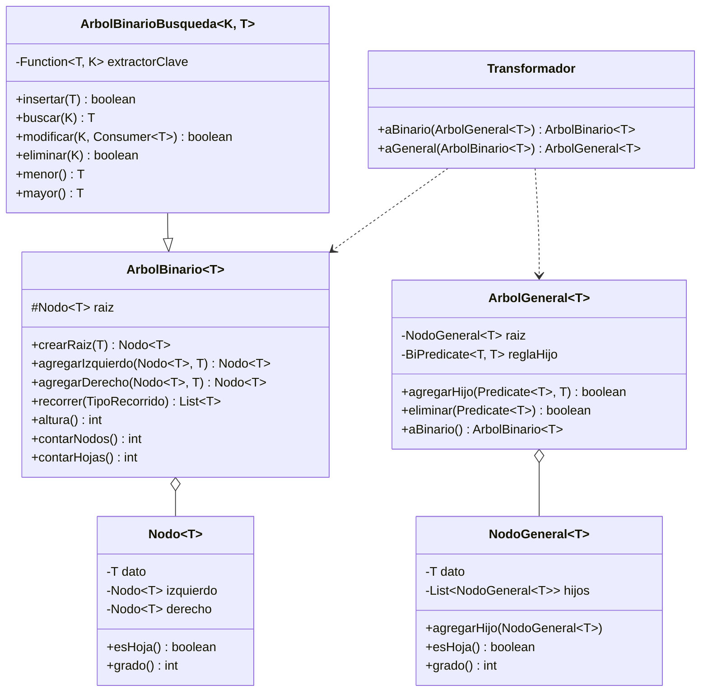
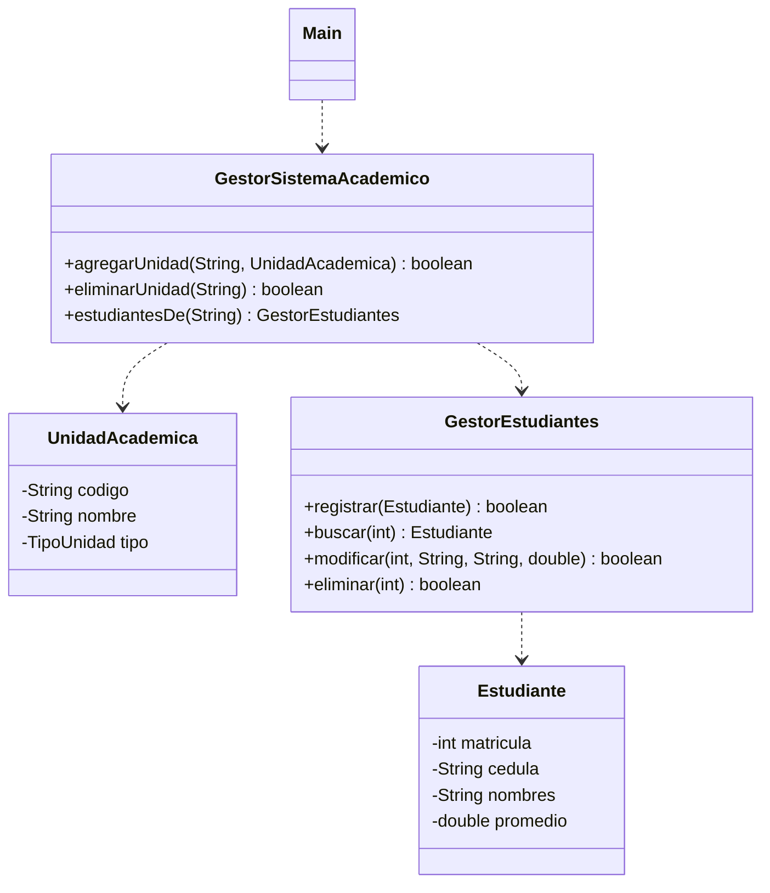
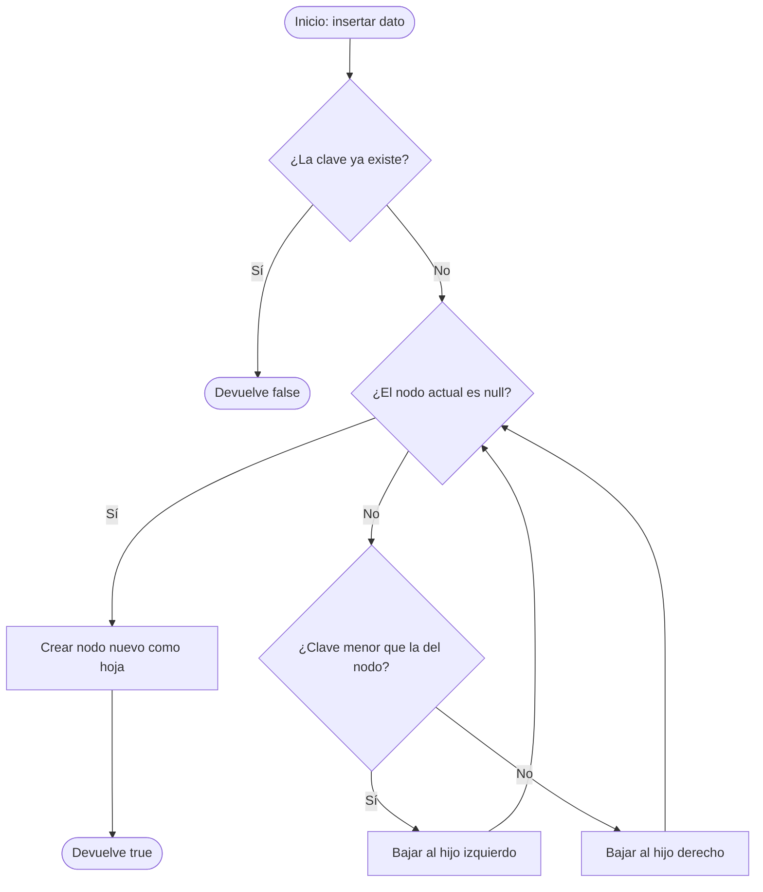
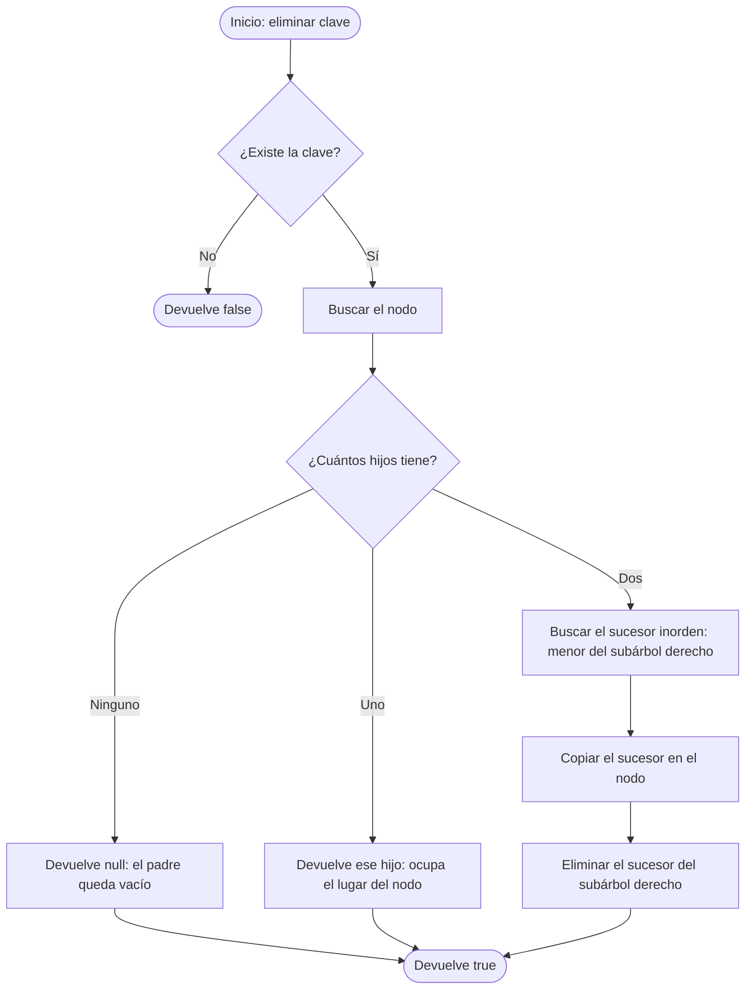
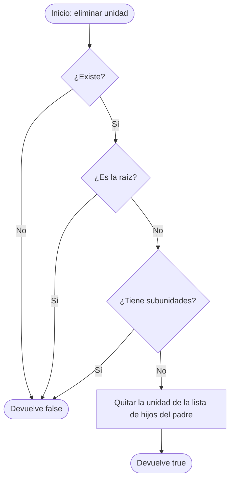
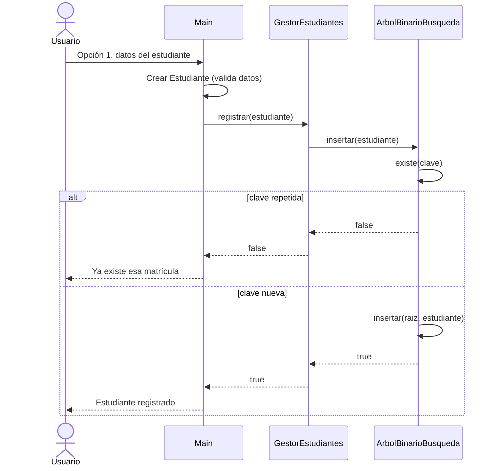
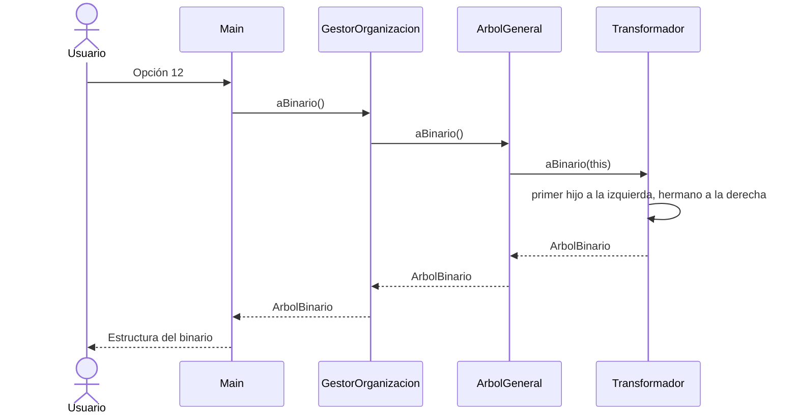
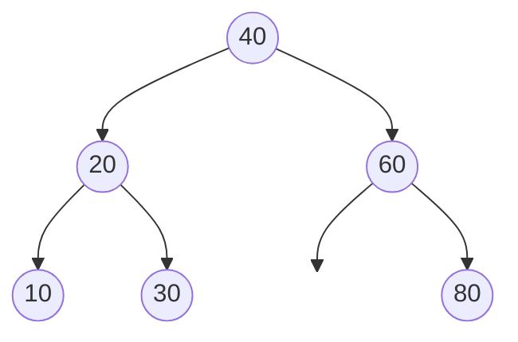
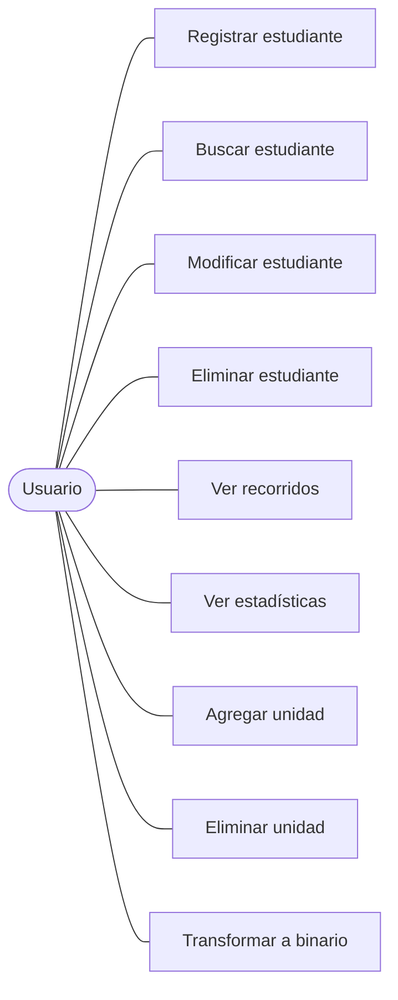

# 07. Diagramas en Mermaid

GitHub dibuja estos bloques directamente en el README o en cualquier `.md`. Copia, cambia los nombres y listo. Para el informe, toma una captura del diagrama ya dibujado, o pega el código en https://mermaid.live y exporta la imagen.

## Diagrama de clases del kit

## Diagrama de clases de un caso (capas)

## Diagrama de flujo: insertar en un ABB

## Diagrama de flujo: eliminar en un ABB

## Diagrama de flujo: eliminar en el árbol general (regla A5)

## Diagrama de secuencia: registrar un estudiante

## Diagrama de secuencia: transformar a binario

## Dibujo de un árbol de ejemplo

## Diagrama de casos de uso (menú)

Si la prueba exige casos de uso en UML, esta es la forma simple. Cambia los nombres por las operaciones del enunciado.
